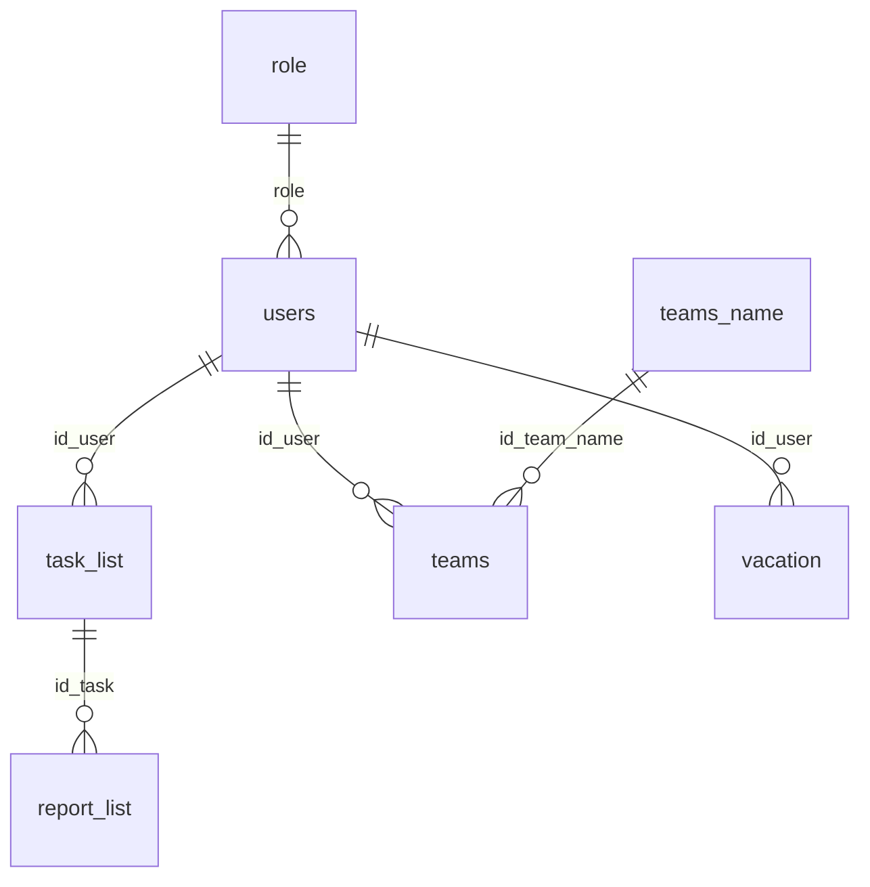

# Контекст проекта

Обновлено: 12 ноября 2026 года. Основание — статический аудит и два согласованных этапа: A02/A04, затем A01/A07 и часть A13. Восстановление, безопасные поля, права API и атомарность отчёта проверены на синтетической БД в отдельном Docker-проекте; frontend — модульно и в headless Chrome на искусственных ответах API. Полная работоспособность приложения и текущая БД не проверялись. Подробности: [AUDIT.md](AUDIT.md), план: [ROADMAP.md](ROADMAP.md).

## Назначение и состояние

DailySync — веб-панель управления сотрудниками, командами, задачами, отчётами о выполнении и отпусками. README описывает автоматизацию ежедневных встреч. Собственных исходников Telegram-бота и планировщика встреч в репозитории нет. Поля Telegram и таблица daily_reports указывают на смежную интеграцию, поведение которой здесь установить нельзя.

Есть интерфейсы менеджера и работника. Это реализованные сценарии кода, а не подтверждение их полной работоспособности. Прямой обход восстановления и серверный контроль доступа исправлены; хеширование паролей, окончательная защита/отзыв сессий и надёжный канал восстановления остаются первоочередными задачами.

## Технологии

Версии взяты из package-lock.json; версии работающих контейнеров не определялись.

| Слой | Реализация |
| --- | --- |
| Frontend | React / React DOM 19.1.0, TypeScript 5.8.3, Vite 6.3.5 |
| UI | Tailwind CSS 4.1.7 с Vite-плагином, обычные CSS, Radix UI, компоненты в стиле shadcn/ui, lucide-react |
| Навигация и HTTP | react-router-dom 7.6.0, Axios 1.10.0 |
| Состояние | useState/useEffect, AuthContext, NotificationContext, sonner 2.0.7, js-cookie 3.0.5 |
| Backend | CommonJS, Express 5.1.0, pg 8.14.1, dotenv 16.5.0 |
| Авторизация | jsonwebtoken 9.0.2; bcrypt 5.1.1 установлен, хеширование и сравнение отключены |
| API docs | swagger-jsdoc 6.2.8, swagger-ui-express 5.0.1, /api-docs |
| БД | Образ postgres:17-alpine; дамп PostgreSQL/pg_dump 17.4 |
| Контейнеры | Docker Compose, node:20-alpine, nginx:stable-alpine |

Lock-файлы формата v3; декларации прямых зависимостей согласованы с package.json. Это не означает отсутствия уязвимостей.

## Структура

```text
backend/
  app.js                 Express, CORS, Swagger, подключение маршрутов, listen
  db.js                  общий pg.Pool
  routes/                auth, users, teams, tasks, reports; OpenAPI-комментарии
  controllers/           HTTP и часть бизнес-логики
  models/                SQL напрямую через pg
  middleware/authMiddleware.js Bearer JWT, текущая роль и проверка собственных данных
  utils/passwordRecovery.js одноразовые разрешения и лимиты восстановления
  tests/                 модульные и HTTP-проверки доступа/восстановления/отчётов
  Dockerfile             Node и npm ci
  node_modules/          присутствует и частично отслеживается Git
  .idea/                 метаданные IDE и подключений к БД
frontend/
  src/main.tsx           StrictMode, BrowserRouter, AuthProvider
  src/App.tsx            маршруты, Header, уведомления
  src/pages/             страницы, диалоги и контексты
  src/components/ui/     переиспользуемые элементы интерфейса
  src/style/             глобальные CSS страниц
  src/index.css          Tailwind и переменные темы
  src/lib/utils.ts       cn: clsx + tailwind-merge
  src/lib/api.ts         защищённый и публичный Axios-клиенты, 401/403 и безопасные логи
  tests/                 проверки клиента/guard и headless браузера
  src/assets/, public/   изображения и локальные шрифты
  Dockerfile, nginx.conf сборка статики и SPA fallback
  vite.config.ts         React/Tailwind плагины, alias, dev proxy
docker-compose.yml       postgres + app + frontend, volume pgdata
docker-compose.recovery-test.yml отдельный тестовый проект, PostgreSQL в tmpfs
itk_old.sql              схема и данные для первой инициализации
.env                     локальные параметры, текущий файл не отслеживается Git
docs/                    контекст, аудит, дорожная карта
```

Отдельных миграций и CI workflow нет. Есть собственные Node tests доступа, восстановления, безопасных DTO и транзакции отчёта, а также frontend-тесты и сценарии headless Chrome. Сторонние тесты в node_modules не являются тестами приложения.

## Frontend

| URL | Компонент | Сценарий |
| --- | --- | --- |
| /login | LoginPage | Вход и интерфейс восстановления пароля |
| /users | users | Поиск, создание/удаление сотрудников; карточка команды, отпуска и задач |
| /teams | Teams | Создание, изменение/удаление команд и участников |
| /tasks_list | TasksList | Сотрудники, количество задач, назначение задач |
| /reports_list | ReportsList | Поиск, фильтр просмотренных и принятие отчётов |
| /vacation_list | VacationList | Создание и список незавершившихся отпусков, включая будущие |
| /tasks | TasksEmploye | Незавершённые задачи сотрудника, отправка отчёта |
| Остальные, включая / | Картинка 404 | Начального перенаправления нет |

Страницы, кроме login/404, вложены в AuthRedirect. AuthContext получает текущего пользователя через /auth/protected; до проверки guard показывает loading, при временном отказе — ошибку/retry, при 401 очищает локальную сессию. Вложенный guard допускает на страницы управления только роль 1. /tasks доступен обеим ролям для собственных задач. Header использует проверенного сервером пользователя; подмена userData не открывает страницу управления.

Токен пока хранится в JavaScript-cookie. userData — только кэш безопасного DTO; AuthContext и страница задач не читают из него идентичность/роль и не разбирают повреждённый JSON. Общий Axios-клиент добавляет Bearer-заголовок, обрабатывает 401/403 и не завершает новую сессию из-за позднего 401 старого токена. Для публичных входа/восстановления есть отдельный клиент без Bearer. Семь страниц используют относительные пути этого клиента; исходный http://localhost:5001/api централизован в src/lib/api.ts. Полная A09 (адресация/proxy) не решена.

Проверка сессии и восстановление имеют timeout 15 секунд. Восстановление сохраняет pending-блокировку и recoveryToken только в состоянии компонента; при ошибке смены пароля форма возвращается к началу восстановления. Систематические состояния загрузки остальных списков не добавлялись. Только login явно передаёт withCredentials: true. При фокусе окна сессия перепроверяется; backend проверяет актуальную роль при каждом запросе.

Vite: alias @ → src, dev-порт 5173, bind 0.0.0.0. Существующая конфигурация содержит proxy /api и /api-docs → http://app:5001. Имя app разрешается внутри сети Compose; на хосте такой DNS по умолчанию отсутствует. Текущий абсолютный baseURL клиента обходит proxy. Vite/Nginx/production Compose во втором этапе не менялись.

## Backend и фактический API

Цепочка: app.js → routes → controllers → models → pg.Pool → PostgreSQL. ORM и отдельного сервисного слоя нет. Пользовательские SQL-значения передаются параметрами $1…$n; прямой SQL-инъекции в собственных запросах статически не найдено.

Включены CORS для http://localhost:8080 с credentials и express.json() по умолчанию. Порт — PORT, иначе 5000. Swagger указывает localhost:5000. Нет общего JSON-обработчика ошибок/404, ограничителя входа, health/readiness endpoint.

| Префикс | Методы и пути | Данные/ответы |
| --- | --- | --- |
| /api/auth | POST /createUser; DELETE /delUser/:id | Создание: fname,lname,tg_id,post,role,pass |
| /api/auth | POST /login; GET /protected | login публичен, tg_id/password — непустые строки; ответ user с JWT и две cookie. protected требует Bearer и возвращает безопасного текущего пользователя |
| /api/auth | POST /recPass, /recAns, /recPass/newPass | Вопрос по tg_id; верный secAns выдаёт recoveryToken на 300 секунд; newPass требует tg_id,textNewPassword,recoveryToken |
| /api/users | GET /; POST /update/:id; GET /delete/:id | Список основных полей; update возвращает только id,fname,lname,tg_id,post,role; отсутствующий пользователь — 404; дублирующее удаление через GET |
| /api/users | POST /vacation/:id; GET /vacation/view | startHoliday,endHoliday; список в {message,user:[…]} |
| /api/users | GET /:id/team, /:id/tasks, /:id/vacation | {user:…}: первая команда/«Отсутствует», массив незавершённых задач, текущий отпуск/«Отсутствует» |
| /api/teams | GET /; POST /create; PUT /edit/:id; DELETE /delete/:id | nameTeam,descriptionTeam; edit: newNameTeam; создание возвращает task.id |
| /api/teams | GET /view/:id; POST /newUserTeam/:id; POST /delUserTeam/:id_team/:id_user | Состав в view; массив usersId; удаление участника |
| /api/tasks | GET /; POST /new; PUT /update/:id; DELETE /delete/:id | Создание: content,id_user,end_date,start_date; update фактически ожидает content,date,status |
| /api/reports | GET /; PUT /accept/:id; POST /new | new: id_task,text_report,end_date, автор из req.user (body.id_user игнорируется); проверка исполнителя, вставка отчёта и завершение задачи в транзакции. accept устанавливает check_report=true |

Все 25 защищённых операций требуют Bearer JWT. Менеджер (роль 1) управляет всеми сотрудниками, командами, задачами и отпусками, читает/принимает отчёты. Работник (роль 2) читает только свои /users/:id/team, /tasks, /vacation. Обе роли создают отчёт только по собственной задаче; чужая или отсутствующая задача — 404. Создание пользователя и оба существующих маршрута удаления пользователя защищены ролью менеджера; изменяющий GET сохранён как незакрытая часть A12. Вход и восстановление остаются публичными. OpenAPI имеет Bearer security по умолчанию и явные публичные исключения.

Отчёт записывается на выделенном pg client: BEGIN → проверка задачи/исполнителя с FOR UPDATE → INSERT отчёта → UPDATE задачи → COMMIT; при ошибке ROLLBACK и release. Исторические данные и схема не изменяются. Повторные/параллельные отчёты по своей задаче по-прежнему допускаются; идемпотентность и переходы состояния требуют отдельного решения.

## Авторизация и роли

В дампе role.id=1 — «Менеджер», 2 — «Работник». post — свободная должность/специализация. Создание пользователя принимает роль из запроса менеджера. JWT подписывается JWT_SECRET, содержит id и срок один час; middleware допускает HS256, требует exp и корректный числовой id. Пользователь загружается из БД в req.user; неизвестная роль отклоняется. Отдельного признака активности в схеме нет — проверяется существование пользователя.

Пароль сохраняется напрямую и сравнивается через ===; bcrypt закомментирован. Login отклоняет пустой/нестроковый пароль, в том числе null. Серверные cookie token/userData: httpOnly:false, secure:false, maxAge один час, без явного SameSite. Frontend устанавливает cookie токена на один час и кэширует безопасный DTO /protected без token. Login по-прежнему возвращает JWT в user.token для совместимости. Выход удаляет cookie, серверного отзыва нет. Смена пароля не отзывает старые JWT.

Восстановление: случайное 256-битное одноразовое разрешение выдаётся после проверки непустого ответа, действует 5 минут и связано с users.id/tg_id. В памяти одного backend-процесса хранятся SHA-256 хеши разрешений; новое отменяет прежнее для пользователя. Разрешение расходуется синхронно до SQL; смена пароля обновляет конкретный id, без изменения схемы БД. Перезапуск отменяет незавершённые разрешения и сбрасывает счётчики. Три маршрута имеют общий лимит 15 запросов на аккаунт и 60 на IP за 15 минут; размеры хранилищ ограничены. При отсутствии вопроса/ответа или неоднозначном tg_id разрешение не выдаётся. Секретный ответ и внутренние ошибки клиенту не возвращаются. Проверочный вопрос сохраняется как ограничение; надёжный канал и работа нескольких процессов требуют отдельного решения.

## База данных

Источник схемы — itk_old.sql, не подключение к существующей БД. Дата дампа: 10 мая 2026 года. Соответствие текущему volume неизвестно. Значения учётных данных не воспроизводятся.

| Таблица | Поля и назначение | Ограничения в дампе |
| --- | --- | --- |
| users | integer id; fname/lname/tg_id/post varchar(255), role integer; password text; question/answer varchar(255); chat_id bigint; pending_report boolean default false | PK, identity ALWAYS; FK role → role.id; tg_id не UNIQUE; password/question/answer/chat_id/pending_report nullable |
| role | integer id; name_role varchar(255) | PK, identity ALWAYS |
| teams_name | integer id; name_team varchar(255), description_team varchar(255) nullable | PK, identity ALWAYS |
| teams | integer id; bigint id_team_name/id_user | PK, identity ALWAYS; FK на teams_name/users; нет уникальности пары |
| task_list | integer id; content varchar(255); bigint id_user; end_date/start_date date; status boolean | PK, identity ALWAYS; два дублирующих FK id_user → users.id |
| report_list | integer id; bigint id_task/id_user; text_report varchar(255); end_date date; status_task boolean; check_report boolean default false nullable | PK, identity ALWAYS; FK только id_task → task_list.id |
| vacation | integer id; bigint id_user; start_holiday/end_holiday date | PK, identity ALWAYS; FK id_user → users.id |
| daily_reports | integer id; chat_id bigint, name/report text, timestamp without time zone | PK; остальные поля nullable; нет identity/default; backend таблицу не использует |

Остальные перечисленные рабочие поля NOT NULL. В FK не задан ON DELETE CASCADE. CHECK порядка дат и индексов, кроме PK, в дампе нет.



report_list.id_user логически используется в JOIN с users, но FK отсутствует. daily_reports изолирована. Два FK task_list → users показаны одной связью. Отношение users ↔ teams_name допускает несколько команд на пользователя, хотя карточка показывает только первую.

## Docker и переменные окружения

Compose определяет три сервиса в стандартной сети:

1. postgres (postgres_db): postgres:17-alpine, публикация ${DB_PORT}:5432, pgdata, дамп в /docker-entrypoint-initdb.d/init_backup.sql, pg_isready.
2. app (node_app): backend build, ${BACKEND_PORT}:${BACKEND_PORT}, NODE_ENV=production, ожидание healthy postgres, node app.js.
3. frontend (vite_frontend): npm ci / vite build, статика Nginx на ${FRONTEND_PORT}:80, зависит от старта app. Vite dev-server здесь не запускается.

Nginx делает SPA fallback на index.html. Проксирования API и TLS в конфигурации нет. Текущая цепочка HTTP: браузер → localhost:5001 → Express → PostgreSQL; Nginx обслуживает только frontend. Backend использует DB_HOST и фиксированный 5432, игнорируя DB_PORT. Внутри Compose обычно нужен postgres:5432; опубликованный DB_PORT — порт хоста.

| Переменная | Использование |
| --- | --- |
| BACKEND_PORT | публикация app и PORT |
| FRONTEND_PORT | порт Nginx на хосте; CORS автоматически не меняется |
| DB_HOST | pg.Pool.host; для Compose должен соответствовать postgres |
| DB_USER, DB_PASSWORD, DB_NAME | bootstrap PostgreSQL и подключение backend |
| DB_PORT | порт PostgreSQL на хосте; передаётся app, но не читается db.js |
| JWT_SECRET | подпись/проверка JWT, без проверки наличия при старте |

Значения .env намеренно не документируются. env_file передаёт app весь корневой .env. Примера env и отдельной dev-конфигурации нет. Дамп выполняется при первой инициализации пустого каталога PostgreSQL; изменение SQL не обновляет существующий volume. Дамп назначает владельца объектов роли postgres — совместимость с другой bootstrap-ролью требует отдельной проверки.

## Проверки и команды

Backend: npm start запускает приложение; npm test — Node test runner. Без RECOVERY_TEST_DATABASE=1 оба интеграционных сценария пропускаются; полный запуск выполняется через отдельный тестовый Compose с проверкой имени/хоста тестовой БД. Frontend: npm run dev, npm run build (только vite build), npm run lint, npm run preview; тесты запускаются явно через Node. Typecheck в build не включён. Инструкции: [backend/tests/README.md](../backend/tests/README.md), [frontend/tests/README.md](../frontend/tests/README.md).

Второй этап: syntax 22 JS-файлов успешен; backend npm test в Docker — 41 passed, 0 failed, 0 skipped (8 модульных тестов, 31 HTTP-подсценарий и два общих сценария). Успешны 9 frontend-тестов, 9 сценариев headless Chrome, build frontend, typecheck Vite и разбор OpenAPI. Общий lint: 16 ошибок/4 предупреждения; typecheck приложения: 174 ошибки. Сравнение с исходным frontend до второго этапа (20/4 и 176) не выявило новых диагностик TypeScript. В Chrome использовались искусственные ответы API; доступ к рабочему backend исключён перехватом до сети. PostgreSQL для API-тестов работала в tmpfs без текущего .env, реального дампа и существующих volumes. Зависимости и production-конфигурация не менялись. Полные результаты обоих этапов и ограничения — в AUDIT.md.
