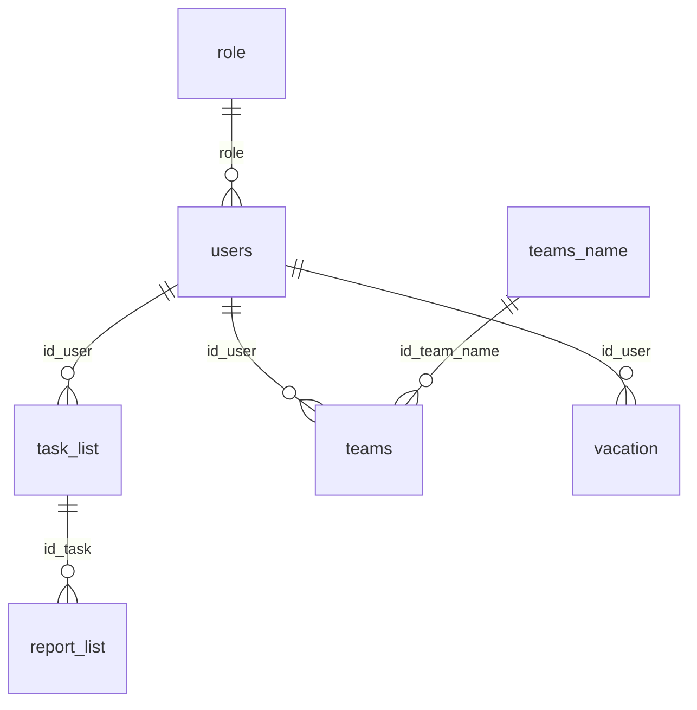

# Контекст проекта

Обновлено: 15 ноября 2026 года. Выполнены десять согласованных этапов. Десятый подготовлен в исходниках: валидация отчёта, блокировка повторной отправки, обновление собственных задач и обработка неопределённого сетевого результата. Рабочее включение этого этапа не выполнялось; рабочие app/frontend/PostgreSQL, .env, данные/схема/volumes и Docker-конфигурация не менялись. Проверки использовали отдельные синтетические БД и искусственный API. Ранее read-only сверка подтвердила формат scrypt у всех 10 рабочих password, legacy/unusable — 0. Положительный вход/logout/reset реальных аккаунтов агент не выполнял. Подробности: [AUDIT.md](AUDIT.md), план: [ROADMAP.md](ROADMAP.md).

## Назначение и состояние

DailySync — веб-панель управления сотрудниками, командами, задачами, отчётами о выполнении и отпусками. Пользователь подтвердил локальный сценарий в одной среде: Docker Compose либо frontend/backend двумя npm-процессами; внешнее развёртывание не планируется. README описывает автоматизацию ежедневных встреч. Собственных исходников Telegram-бота и планировщика встреч в репозитории нет. Поля Telegram и таблица daily_reports указывают на смежную интеграцию, поведение которой здесь установить нельзя.

Есть интерфейсы менеджера и работника. Это реализованные сценарии кода, а не подтверждение их полной работоспособности. Прямой обход восстановления и серверный контроль доступа исправлены, поддерживаемый формат scrypt подтверждён у текущих рабочих password, отзыв при logout/reset реализован и включён. Защита хранения/передачи токена, ранее раскрытые реквизиты/дамп A05 и надёжный канал восстановления остаются первоочередными задачами.

## Технологии

Версии npm-зависимостей взяты из package-lock.json. Восьмым этапом рабочие образы сверены с проверенными сборками; backend использует Node 24.22.3, его исходники и lock-файлы совпадают с репозиторием.

| Слой | Реализация |
| --- | --- |
| Frontend | React / React DOM 19.1.0, TypeScript 5.8.3, Vite 6.4.6 (точно закреплён) |
| UI | Tailwind CSS 4.1.7 с Vite-плагином, обычные CSS, Radix UI, компоненты в стиле shadcn/ui, lucide-react |
| Навигация и HTTP | react-router-dom 7.6.0, Axios 1.10.0 |
| Состояние | useState/useEffect, AuthContext, NotificationContext, sonner 2.0.7, js-cookie 3.0.5 |
| Backend | CommonJS, Express 5.1.0, pg 8.14.1, dotenv 16.5.0 |
| Авторизация | jsonwebtoken 9.0.2; встроенный crypto.scrypt для паролей; bcrypt 5.1.1 остаётся в зависимостях, но не используется |
| API docs | swagger-jsdoc 6.2.8, swagger-ui-express 5.0.1, /api-docs |
| БД | Образ postgres:17-alpine; дамп PostgreSQL/pg_dump 17.4 |
| Контейнеры | Docker Compose, node:24-alpine с digest в обоих Dockerfile (проверен Node 24.22.3, linux/arm64), nginx:stable-alpine |

Lock-файлы формата v3; декларации прямых зависимостей согласованы с package.json. Это не означает отсутствия уязвимостей.

## Структура

```text
backend/
  app.js                 Express, CORS, Swagger, подключение маршрутов, listen
  db.js                  общий pg.Pool
  routes/                auth, users, teams, tasks, reports; OpenAPI-комментарии
  controllers/           HTTP и часть бизнес-логики
  models/                SQL напрямую через pg
  middleware/authMiddleware.js Bearer JWT, текущая роль и проверка собственных данных
  utils/passwordRecovery.js одноразовые разрешения и лимиты восстановления
  utils/passwords.js     scrypt, ограниченная очередь и временный legacy-переход
  utils/loginAttempts.js ограничение запросов входа по аккаунту/IP
  utils/userValidation.js поля сотрудников и совместимый с login tg_id
  utils/reportValidation.js текст отчёта и реальные календарные даты/ISO timestamp
  scripts/migrate-passwords.js dry-run и явное условное преобразование записей
  scripts/migrate-sessions.js read-only проверка и добавление версии сессий
  tests/                 модульные и HTTP-проверки доступа/восстановления/отчётов
  Dockerfile             Node и npm ci
  node_modules/          присутствует и частично отслеживается Git
  .idea/                 метаданные IDE и подключений к БД
frontend/
  src/main.tsx           StrictMode, BrowserRouter, AuthProvider
  src/App.tsx            маршруты, Header, уведомления
  src/pages/             страницы, диалоги и контексты
  src/components/ui/     переиспользуемые элементы интерфейса
  src/style/             глобальные CSS страниц
  src/index.css          Tailwind и переменные темы
  src/lib/utils.ts       cn: clsx + tailwind-merge
  src/lib/api.ts         защищённый и публичный Axios-клиенты, 401/403 и безопасные логи
  tests/                 проверки клиента/guard и headless браузера
  src/assets/, public/   изображения и локальные шрифты
  Dockerfile, nginx.conf сборка статики и SPA fallback
  vite.config.ts         React/Tailwind плагины, alias, dev proxy
docker-compose.yml       postgres + app + frontend, volume pgdata
docker-compose.recovery-test.yml отдельный тестовый проект, PostgreSQL в tmpfs
itk_old.sql              схема и данные для первой инициализации
.env                     локальные параметры, текущий файл не отслеживается Git
docs/                    контекст, аудит, дорожная карта
```

Общего механизма миграций и CI workflow нет; есть отдельный явный скрипт добавления session_version. Есть собственные Node tests доступа, восстановления, отзыва сессий, безопасных DTO и транзакции отчёта, а также frontend-тесты и сценарии headless Chrome. Сторонние тесты в node_modules не являются тестами приложения.

## Frontend

| URL | Компонент | Сценарий |
| --- | --- | --- |
| /login | LoginPage | Вход и интерфейс восстановления пароля |
| /users | users | Поиск, создание/удаление сотрудников; карточка команды, отпуска и задач |
| /teams | Teams | Создание, изменение/удаление команд и участников |
| /tasks_list | TasksList | Сотрудники, количество задач, назначение задач |
| /reports_list | ReportsList | Поиск, фильтр просмотренных и принятие отчётов |
| /vacation_list | VacationList | Создание и список незавершившихся отпусков, включая будущие |
| /tasks | TasksEmploye | Незавершённые задачи сотрудника, отправка отчёта |
| Остальные, включая / | Картинка 404 | Начального перенаправления нет |

Страницы, кроме login/404, вложены в AuthRedirect. AuthContext получает текущего пользователя через /auth/protected; до первой проверки guard показывает loading, при временном отказе — ошибку/retry, при 401 очищает локальную сессию. Фоновая проверка прежней сессии сохраняет проверенную страницу и черновики; временный отказ показывает предупреждение/retry, новые отправки блокируются до успешной проверки. При смене токена/пользователя, 401 либо 403 проверки сессии доступ закрывается; потеря роли закрывает соответствующую страницу, дерево которой также привязано к id проверенного пользователя. Обычный 403 бизнес-запроса по-прежнему показывает сообщение без выхода. Вложенный guard допускает на страницы управления только роль 1. /tasks доступен обеим ролям для собственных задач. Header использует проверенного сервером пользователя; подмена userData не открывает страницу управления.

Токен пока хранится в JavaScript-cookie. userData — только кэш безопасного DTO; AuthContext и страница задач не читают из него идентичность/роль и не разбирают повреждённый JSON. Общий Axios-клиент добавляет Bearer-заголовок, обрабатывает 401/403 и не завершает новую сессию из-за позднего 401 старого токена. AuthContext разрешает новые изменяющие запросы только после проверки текущего токена; клиент сопоставляет проверенный token, cookie и Bearer. POST/PUT/PATCH/DELETE и старый GET удаления пользователя блокируются до первой/во время фоновой проверки и после её временного отказа; успешный ответ снова разрешает отправку. Это защита поведения UI, серверный контроль доступа остаётся обязательным. Уже отправленные запросы не отменяются. Для публичных входа/восстановления есть отдельный клиент без Bearer. Семь страниц используют относительные пути общего клиента с baseURL=/api. Браузер обращается к origin frontend; Vite/Nginx направляют запросы в backend. Оба публичный/защищённый клиенты используют один относительный префикс.

Проверка сессии, вход, создание пользователя, восстановление, отправка отчёта и загрузка собственных задач имеют timeout 15 секунд. Формы входа/создания/reset/отчёта блокируют повторную отправку и показывают ошибки. Восстановление хранит recoveryToken только в состоянии компонента; при ошибке смены пароля форма возвращается к началу восстановления. Новых требований длины пароля нет; прежний локальный лимит reset 1024 символа снят. Остальные списки ещё не имеют систематических состояний загрузки. Только login явно передаёт withCredentials: true. При фокусе окна сессия перепроверяется; backend проверяет актуальную роль при каждом запросе.

Собственные задачи после десятого этапа различают loading/error/empty и предлагают повтор GET. Подтверждённый отчёт сразу убирает задачу из списка и запускает перечитывание; поздние GET не возвращают завершённую запись. Отказ перечитывания не повторяет POST. Во время отправки поле и кнопка заблокированы; ошибка сохраняет черновик. При сетевом отказе/timeout результат считается неопределённым: повтор POST заблокирован до успешного обновления списка кнопкой в форме. Обновление не повторяет отправку автоматически; если задача осталась, ручная попытка снова доступна. Это не серверная идемпотентность: прежний запрос может продолжать выполняться. При смене проверенного пользователя поздние ответы не обновляют его страницу.

Vite: alias @ → src, dev-порт 5173, dev/preview слушают 127.0.0.1. Контейнерные тесты явно задают --host 0.0.0.0 и публикуют только loopback-порты. Proxy /api и /api-docs в dev/preview берёт API_PROXY_TARGET из окружения/frontend .env; default http://127.0.0.1:5000 совпадает с default PORT backend. В Docker frontend раздаёт Nginx, а не Vite. Инструкция обоих способов запуска: [frontend/README.md](../frontend/README.md).

## Backend и фактический API

Описание ниже относится к актуальным исходникам. Десятый этап пока не развёрнут в рабочих API/UI; историю предыдущих включений см. в AUDIT.md.

Сотрудники после девятого этапа: fname/lname/post — непустые строки до 255 Unicode-символов, tg_id — непустая строка до 255 UTF-16 единиц для совместимости с действующим входом/recovery, role — число 1 либо 2. NUL и одиночные суррогаты отклоняются; значения не обрезаются/не нормализуются. При API-изменении проверяются также положительный integer id и наличие записи. Создание возвращает только id/fname/lname/tg_id/post/role через RETURNING и явный DTO; пароль и внутренние поля отсутствуют. Известный tg_id — 409, неверные поля — 400, отсутствующий пользователь при изменении — 404; прежний успешный статус изменения 201 сохранён. Новых правил паролей нет. Отдельный SELECT перед INSERT не гарантирует уникальность при параллельном создании; ограничения БД остаются A15.

Форма создания сохраняет черновик при ошибке и блокирует поля/роль на время POST. После 201 родитель сразу добавляет safe DTO и перечитывает список; отдельный GET имеет timeout 15 секунд, error/retry и проверку актуальности ответа. Ошибка reload не отменяет успешное создание и не повторяет POST. После успешного удаления ответ ранее начатой загрузки также игнорируется. Успех очищает поля и видимый выбор роли. Добавлена типизация DTO/props/списка; прочие ошибки типов страницы/контекстов остаются.

Цепочка: app.js → routes → controllers → models → pg.Pool → PostgreSQL. ORM и отдельного сервисного слоя нет. Пользовательские SQL-значения передаются параметрами $1…$n; прямой SQL-инъекции в собственных запросах статически не найдено.

Включены CORS для http://localhost:8080 с credentials и express.json() по умолчанию. Порт — PORT, иначе 5000. Swagger использует относительный сервер /, подходящий для прямого backend и frontend proxy. Вход и восстановление имеют свои лимиты запросов. Общего JSON-обработчика ошибок/404 и health/readiness endpoint нет.

| Префикс | Методы и пути | Данные/ответы |
| --- | --- | --- |
| /api/auth | POST /createUser; DELETE /delUser/:id | Создание: fname,lname,tg_id,post,role,pass; проверка полей до SQL, 201 с безопасным user, существующий tg_id — 409 |
| /api/auth | POST /login; GET /protected; POST /logout | login публичен, scrypt, единая ошибка реквизитов, лимит 10/account и 60/IP за 15 мин; ответ user с JWT и две cookie. protected требует Bearer и возвращает безопасного текущего пользователя; logout отзывает все прежние сессии пользователя |
| /api/auth | POST /recPass, /recAns, /recPass/newPass | Вопрос по tg_id; верный secAns выдаёт recoveryToken на 300 секунд; newPass требует tg_id,textNewPassword,recoveryToken |
| /api/users | GET /; POST /update/:id; GET /delete/:id | Список основных полей; update возвращает только id,fname,lname,tg_id,post,role; отсутствующий пользователь — 404; дублирующее удаление через GET |
| /api/users | POST /vacation/:id; GET /vacation/view | startHoliday,endHoliday; список в {message,user:[…]} |
| /api/users | GET /:id/team, /:id/tasks, /:id/vacation | {user:…}: первая команда/«Отсутствует», массив незавершённых задач, текущий отпуск/«Отсутствует» |
| /api/teams | GET /; POST /create; PUT /edit/:id; DELETE /delete/:id | nameTeam,descriptionTeam; edit: newNameTeam; create/edit принимают optional usersId и атомарно сохраняют команду с участниками; создание возвращает task.id |
| /api/teams | GET /view/:id; POST /newUserTeam/:id; POST /delUserTeam/:id_team/:id_user | Состав в view; массив usersId; удаление участника |
| /api/tasks | GET /; POST /new; PUT /update/:id; DELETE /delete/:id | Создание: content,id_user,end_date,start_date; update фактически ожидает content,date,status |
| /api/reports | GET /; PUT /accept/:id; POST /new | new: id_task,text_report,end_date, автор из req.user (body.id_user игнорируется); проверка исполнителя, вставка отчёта и завершение задачи в транзакции. accept устанавливает check_report=true |

Все 26 защищённых операций требуют Bearer JWT. Менеджер (роль 1) управляет всеми сотрудниками, командами, задачами и отпусками, читает/принимает отчёты. Работник (роль 2) читает только свои /users/:id/team, /tasks, /vacation. Обе роли создают отчёт только по собственной задаче; чужая или отсутствующая задача — 404. Выход доступен обеим ролям. Создание пользователя и оба существующих маршрута удаления пользователя защищены ролью менеджера; изменяющий GET сохранён как незакрытая часть A12. Вход и восстановление остаются публичными. OpenAPI имеет Bearer security по умолчанию и явные публичные исключения.

Отчёт до модели проверяет положительный id в пределах integer PK, непустой текст до 255 Unicode-символов без NUL/одиночных суррогатов и реальную дату YYYY-MM-DD (годы 0001–9999) либо ISO timestamp с явным Z/смещением до 15:59, максимум 40 символов. Невозможные дни/время и неверные типы получают 400. Текст не обрезается/не нормализуется; дата передаётся прежнему SQL без пересчёта в UTC, календарная часть ISO сохраняется как раньше. Это не общий переход задач/отпусков к date-only A20.

Отчёт записывается на выделенном pg client: BEGIN → проверка задачи/исполнителя с FOR UPDATE → INSERT отчёта → UPDATE задачи → COMMIT; при ошибке ROLLBACK и release. Модель/транзакция этим этапом не менялись. Исторические данные и схема не изменяются. Повторные/параллельные отчёты по своей задаче по-прежнему допускаются; идемпотентность и переходы состояния требуют отдельного решения.

Операции команд используют транзакции на выделенном pg client. Edit/add/remove/delete блокируют строку команды; добавление проверяет пользователей и пропускает повторные id/уже существующие связи. Удаление сначала убирает связи, затем команду; пользователей, задачи и отчёты не удаляет. Create/edit с usersId сохраняются целиком или откатываются. Существующие дубли и схема БД не меняются; глобального UNIQUE нет, сторонние SQL-писатели этим механизмом не защищены (A15). UI отправляет один запрос create/edit, блокирует повторы, обновляет состав после сохранения/открытия, очищает выбор и показывает ошибку загрузки с retry.

После шестого этапа текстовые поля команды и selection инициализируются при открытии окна отдельно от загрузки состава. Retry/обновление участников не сбрасывают черновик; из selection исключаются уже вошедшие в состав пользователи. Во время create/edit текстовый ввод заблокирован, ошибка сохраняет черновик/выбор, успешное сохранение очищает selection и перечитывает участников. В окнах команды есть повтор проверки сессии при её временном отказе.

## Авторизация и роли

В дампе role.id=1 — «Менеджер», 2 — «Работник». post — свободная должность/специализация. Создание пользователя принимает роль из запроса менеджера. JWT подписывается JWT_SECRET, содержит id, числовую sessionVersion и срок один час; middleware допускает HS256, требует exp, корректные id/версию и совпадение версии с users.session_version. JWT без версии отклоняется. Пользователь загружается из БД в req.user; неизвестная роль отклоняется. Отдельного признака активности в схеме нет — проверяется существование пользователя.

Создание и reset сохраняют scrypt-хеш в прежнем password text. Формат `scrypt$1$32768$8$3$<salt hex>$<key hex>`: N=32768,r=8,p=3, соль 16 байт, ключ 64 байта. Содержимое пароля целиком кодируется UTF-8 без нормализации/обрезания; новые правила длины не вводились, сохранилась проверка непустой строки. На процесс разрешены 2 активных KDF и 16 ожидающих, maxmem одного вызова 64 МиБ, переполнение даёт 503. Проверка ключей timingSafeEqual; неизвестный аккаунт тоже выполняет один KDF.

Для старого plaintext-входа нужен явно заданный будущий LEGACY_PASSWORD_LOGIN_UNTIL с часовым поясом. По умолчанию он выключен; перезапуск не продлевает дату. Успешный вход преобразует запись условным UPDATE по id/старому значению; при конфликте проверяет актуальный хеш до выдачи JWT. Скрипт преобразования по умолчанию READ ONLY dry-run, требует явного имени БД, а запись — ещё и --apply. Учитывает все id, сохраняет остальные поля, не перезаписывает параллельный reset; повторный запуск пропускает готовые хеши. Непригодные/подозрительные форматы считаются отдельно без вывода значений.

**Текущий снимок password проверен восьмым этапом:** 10 scrypt, 0 legacy, 0 unusable, legacy-вход выключен. Повторное преобразование и временное окно совместимости не требовались. Рабочие password и .env агент не менял; кем и когда были преобразованы записи, не устанавливалось. Поддерживаемый формат не подтверждает вход по паролю каждого реального аккаунта. Для других сред или будущих legacy-записей сохраняется отдельная процедура и необходимость согласовать запись: [инструкция](../backend/scripts/README.md). Внешние потребители users.password не проверялись; scrypt не обезвреживает ранее раскрытые реквизиты/дамп A05.

Серверные cookie token/userData: httpOnly:false, secure:false, maxAge один час, без явного SameSite. Frontend устанавливает cookie токена на один час и кэширует безопасный DTO /protected без token. Login по-прежнему возвращает JWT в user.token для совместимости. POST /auth/logout условно увеличивает session_version по id и прежней версии: прежние JWT пользователя отклоняются при последующих проверках, новый вход не затрагивается повторным старым logout. Сервер не отправляет Set-Cookie при выходе, cookie удаляет frontend сразу. Запрос выполняется через publicApi с явным прежним Bearer и timeout 15 секунд, включая ошибку фоновой проверки; автоматический 401 выполняет только локальную очистку. При сетевой/серверной ошибке сообщается, что отзыв не подтверждён; поздний ответ не удаляет новую cookie. Действующий reset меняет пароль и увеличивает версию одним UPDATE. Отдельной авторизованной смены пароля пока нет; её нужно связать с этим же механизмом. Уже начатые бизнес-операции не отменяются.

Восстановление: случайное 256-битное одноразовое разрешение выдаётся после проверки непустого ответа, действует 5 минут и связано с users.id/tg_id. В памяти одного backend-процесса хранятся SHA-256 хеши разрешений; новое отменяет прежнее для пользователя. Разрешение расходуется синхронно до SQL; сброс обновляет пароль конкретного id и версию сессий одним SQL. Перезапуск отменяет незавершённые разрешения и сбрасывает счётчики. Три маршрута имеют общий лимит 15 запросов на аккаунт и 60 на IP за 15 минут; размеры хранилищ ограничены. При отсутствии вопроса/ответа или неоднозначном tg_id разрешение не выдаётся. Секретный ответ и внутренние ошибки клиенту не возвращаются. Проверочный вопрос сохраняется как ограничение; надёжный канал и работа нескольких процессов требуют отдельного решения.

## База данных

Таблица ниже описывает исторический itk_old.sql от 10 мая 2026 года; полное соответствие рабочей схемы ему не проверялось. 15 ноября отдельно проверены users.id и новое users.session_version; последнее добавлено в рабочую БД согласованной миграцией. В дампе этого поля нет: после нового bootstrap перед запуском нового backend обязательно выполнить scripts/migrate-sessions.js. Повторная загрузка дампа не требуется. Значения учётных данных не воспроизводятся.

| Таблица | Поля и назначение | Ограничения в дампе |
| --- | --- | --- |
| users | integer id; fname/lname/tg_id/post varchar(255), role integer; password text; question/answer varchar(255); chat_id bigint; pending_report boolean default false | PK, identity ALWAYS; FK role → role.id; tg_id не UNIQUE; password/question/answer/chat_id/pending_report nullable |
| role | integer id; name_role varchar(255) | PK, identity ALWAYS |
| teams_name | integer id; name_team varchar(255), description_team varchar(255) nullable | PK, identity ALWAYS |
| teams | integer id; bigint id_team_name/id_user | PK, identity ALWAYS; FK на teams_name/users; нет уникальности пары |
| task_list | integer id; content varchar(255); bigint id_user; end_date/start_date date; status boolean | PK, identity ALWAYS; два дублирующих FK id_user → users.id |
| report_list | integer id; bigint id_task/id_user; text_report varchar(255); end_date date; status_task boolean; check_report boolean default false nullable | PK, identity ALWAYS; FK только id_task → task_list.id |
| vacation | integer id; bigint id_user; start_holiday/end_holiday date | PK, identity ALWAYS; FK id_user → users.id |
| daily_reports | integer id; chat_id bigint, name/report text, timestamp without time zone | PK; остальные поля nullable; нет identity/default; backend таблицу не использует |

Остальные перечисленные рабочие поля NOT NULL. В FK не задан ON DELETE CASCADE. CHECK порядка дат и индексов, кроме PK, в дампе нет.



report_list.id_user логически используется в JOIN с users, но FK отсутствует. daily_reports изолирована. Два FK task_list → users показаны одной связью. Отношение users ↔ teams_name допускает несколько команд на пользователя, хотя карточка показывает только первую.

## Docker и переменные окружения

Compose определяет три сервиса в стандартной сети:

1. postgres (postgres_db): postgres:17-alpine, публикация ${DB_PORT}:5432, pgdata, дамп в /docker-entrypoint-initdb.d/init_backup.sql, pg_isready.
2. app (node_app): backend build, ${BACKEND_PORT}:${BACKEND_PORT}, NODE_ENV=production, ожидание healthy postgres, node app.js.
3. frontend (vite_frontend): npm ci / vite build, статика Nginx на ${FRONTEND_PORT}:80, зависит от старта app. Vite dev-server здесь не запускается.

Nginx делает SPA fallback на index.html и передаёт /api, /api-docs в runtime API_UPSTREAM без изменения URI. Шаблон заполняется entrypoint официального образа только для API_UPSTREAM; переменные Nginx сохраняются. Docker DNS с коротким кэшем учитывает замену backend. Цепочка Docker: браузер → Nginx → app:<BACKEND_PORT> → postgres:5432. Два npm-процесса: браузер → Vite → API_PROXY_TARGET → локальный backend → опубликованный порт PostgreSQL. pg читает DB_PORT (default 5432), Compose app явно получает внутренний 5432. TLS в конфигурации нет. Backend не доверяет X-Forwarded-For, Nginx перезаписывает его; лимит по IP через локальный proxy общий для среды, по аккаунту остаётся отдельным.

| Переменная | Использование |
| --- | --- |
| BACKEND_PORT | публикация app и PORT |
| FRONTEND_PORT | порт Nginx на хосте; CORS автоматически не меняется |
| DB_HOST | pg.Pool.host; для Compose должен соответствовать postgres |
| DB_USER, DB_PASSWORD, DB_NAME | bootstrap PostgreSQL и подключение backend |
| DB_PORT | в корневом Compose env — опубликованный порт БД; app получает внутренний 5432. Для npm backend — реальный порт подключения, default 5432 |
| API_PROXY_TARGET | адрес backend для Vite dev/preview, default http://127.0.0.1:5000; не публикуется в браузерном коде |
| API_UPSTREAM | адрес backend для Nginx; Compose задаёт http://app:<BACKEND_PORT> при старте frontend |
| JWT_SECRET | подпись/проверка JWT, без проверки наличия при старте |
| LEGACY_PASSWORD_LOGIN_UNTIL | необязательная абсолютная дата окончания plaintext-входа; без неё режим выключен; рабочее значение не задавалось |

Значения .env намеренно не документируются. env_file передаёт app весь корневой .env. Добавлены backend/.env.example и frontend/.env.example без рабочих секретов. Npm backend запускается из backend и читает backend/.env, а не корневой файл. Существующие команды npm не менялись. Дамп выполняется при первой инициализации пустого каталога PostgreSQL; изменение SQL не обновляет существующий volume. Дамп назначает владельца объектов роли postgres — совместимость с другой bootstrap-ролью требует отдельной проверки.

## Проверки и команды

Десятый этап: 114 backend-проверок без пропусков, 21 frontend-проверка, 45 прежних и 13 новых браузерных сценариев успешны; новые 13 повторены на Nginx и Vite. Настоящий браузер через оба тестовых proxy подтвердил отчёт одним POST и исчезновение задачи, прежние сотрудники/команды/logout. Build, syntax 38 backend JS, OpenAPI, nginx -t, lint изменённой страницы и TypeScript Vite прошли. Общий lint — 5 ошибок/4 предупреждения, TypeScript приложения — 97 ошибок (было 7/4 и 110), новых нормализованных диагностик нет. Общие проверки остаются неуспешными. Рабочее включение не выполнялось.

Девятый этап: 105 backend-проверок (16 unit, 81 интеграционный подсценарий, 8 общих сценариев) без пропусков, 21 frontend-проверка, 45 сценариев Chrome с искусственным API успешны. Реальный браузер через оба тестовых proxy подтвердил создание/появление сотрудника/сброс роли/удаление тестовой записи, команды и logout. Build, syntax 36 backend JS, OpenAPI и nginx -t прошли. Общий lint — 7 ошибок/4 предупреждения, TypeScript — 110 ошибок (было 8/4 и 122), новых нормализованных диагностик нет; общие проверки остаются неуспешными. Рабочее включение не выполнялось.

Восьмой этап: сборка по существующим Dockerfile/lock успешна; 93 backend-проверки без пропусков, 21 frontend-проверка, 38 сценариев Chrome с искусственным API и реальные тестовые Nginx/Vite → Express → PostgreSQL повторно прошли. Настоящий браузер через оба тестовых proxy подтвердил вход, команды, logout и отказ старому JWT. Syntax 34 backend JS, OpenAPI и nginx -t успешны. Общий lint остаётся 8 ошибок/4 предупреждения, TypeScript приложения — 122 ошибки. В рабочей среде обновлены только app/frontend проверенными образами: SPA/новые assets — 200, защищённые API без авторизации — 401 JSON/no-store, OpenAPI содержит logout, анонимный Chrome перенаправлен на форму входа без ошибок JS. Рабочие аккаунты не использовались. Данные восьми таблиц, id/время запуска/mounts PostgreSQL не изменились. Подробности и путь свежей копии — в восьмом этапе AUDIT.md.

Седьмой этап: 93 backend-проверки без пропусков, 21 frontend-проверка, 38 сценариев Chrome с искусственным API успешны. Проверены реальные Nginx/Vite → Express → синтетическая PostgreSQL, включая logout и отказ отозванному JWT, а также настоящий браузер через оба proxy. Build, nginx -t, syntax 34 backend JS и разбор OpenAPI успешны. Общий lint остался 8 ошибок/4 предупреждения, TypeScript приложения — 122 ошибки (было 123), новых нормализованных диагностик нет. Схема рабочей БД изменена только на согласованное поле после backup/restore; новые API/UI пока не развёрнуты. A06 закрыта только в части отзыва при существующих logout/reset, хранение cookie/HTTP остаётся открытым.

Шестой этап: A38/A39 воспроизведены на исходной сборке, затем исправлены. Прошли 21 frontend-проверка (14 client/guard, 6 Vite-подсценариев и общий сценарий) и 33 сценария Chrome с искусственным API, включая истечение cookie во время ввода, смену роли/пользователя и поздние ответы. Сборка успешна; общий lint остался 8 ошибок/4 предупреждения, TypeScript — 123 ошибки без новых диагностик; в изменённых исходниках lint-ошибок нет. PostgreSQL, backend и рабочие сервисы не менялись; реальные HTTP/SQL-проверки в этом этапе не повторялись. Настройки, первая смена пароля/сброс менеджером и ИИ пока только запланированы.

Backend: npm start запускает приложение; npm test — Node test runner с последовательным запуском файлов для ограничения нагрузки KDF. Без RECOVERY_TEST_DATABASE=1 девять интеграционных сценариев пропускаются; полный запуск выполняется через отдельный тестовый Compose с проверкой имени/хоста тестовой БД. Миграция проверяется на дополнительной синтетической БД внутри тестового PostgreSQL. Frontend: npm run dev, npm run build (только vite build), npm run lint, npm run preview; тесты запускаются явно через Node. tests/dev-server.test.mjs проверяет настоящий Vite dev/preview, loopback/Host, proxy, HMR и границы искусственных файлов без внешней сети/БД. browser-reports.mjs отдельно проверяет форму отчёта/собственные задачи и реальные timeout с искусственным API. Typecheck в build не включён. Инструкции: [backend/tests/README.md](../backend/tests/README.md), [frontend/tests/README.md](../frontend/tests/README.md).

Третий этап: syntax 29 JS-файлов успешен; backend npm test в Docker — 66 passed, 0 failed, 0 skipped (16 модульных тестов, 46 интеграционных подсценариев и 4 общих сценария). Успешны 9 frontend-тестов, 12 сценариев headless Chrome, build frontend, lint LoginPage, typecheck Vite и OpenAPI. Общий lint — 15 ошибок/4 предупреждения, TypeScript — 173 ошибки; до этапа было 16/4 и 174, новых диагностик TypeScript нет. Замер scrypt в Docker Node 20.20.2: hash 145 мс, verify 138 мс, 6 одновременных hash 441 мс, пик RSS процесса около 108 МиБ. Это не production-бенчмарк. В Chrome API искусственный, PostgreSQL тестовая в tmpfs без текущего .env, дампа и volumes. Зависимости, lock-файлы и production-конфигурация не менялись. Результаты всех этапов и ограничения — в AUDIT.md.


Четвёртый этап: syntax 31 backend JS, 78 backend-тестов (16 unit, 57 интеграционных подсценариев и 5 общих сценариев), 9 frontend-тестов и 17 mock-браузерных сценариев успешны. Build, nginx -t, lint изменённых TS-файлов, typecheck Vite и OpenAPI parse успешны. Общие lint/typecheck остаются неуспешными: 8 ошибок/4 предупреждения и 123 ошибки TypeScript (до этапа 15/4 и 173), новых нормализованных диагностик нет. Проверены реальные Nginx/Vite → Express → синтетическая PostgreSQL, включая ошибки API, и настоящий браузер через Docker frontend и два npm-процесса на компьютере. Host-режим — Node 24.20.0 во временной копии с npm ci и нестандартными портами; PostgreSQL 17 в Docker. Рабочие сервисы не пересобирались/не перезапускались, изменения конфигурации только подготовлены. Подробности/ограничения — AUDIT.md; следующий этап автоматически не начинается.

Пятый этап: чистые Docker-сборки по lock на закреплённом Node 24.22.3 успешны, нативный bcrypt загружается. Полный backend — 78 passed без пропусков; frontend — 9 прежних тестов и 6 новых подсценариев Vite с общим сценарием (16 passed при совместном запуске). Новые проверки включают HMR, proxy/статусы/заголовки и блокировку искусственных файлов вне корня, в том числе после безвредной virtual-module injection. Прошли 17 mock-браузерных сценариев, настоящий UI login/команды через тестовые Nginx и Vite, proxy smoke и nginx -t. При отказе тестового backend API возвращает 502 у Nginx/500 у Vite, SPA — 200. Typecheck Vite успешен; общий lint остался 8 ошибок/4 предупреждения, TypeScript приложения — 123 ошибки, новых нормализованных диагностик нет. Выборочный npm audit lock-файлов сообщает 21 замечание frontend и 12 backend; Vite в отчёте отсутствует, достижимость остальных advisories требует отдельного анализа. A03 для рабочих паролей, A05/A06, A24 (порты/Express), A29, A37–A39 и прочие незакрытые части остаются открытыми. Данные, схема, .env и volumes рабочей БД не менялись; текущий node_modules не переустанавливался.
